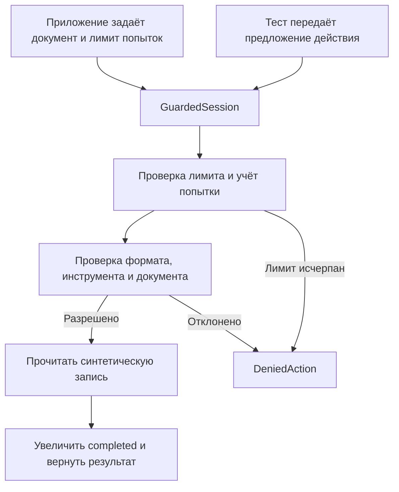
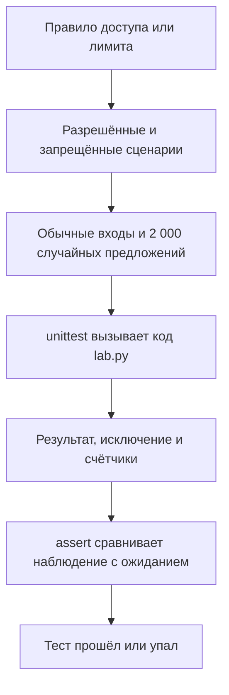
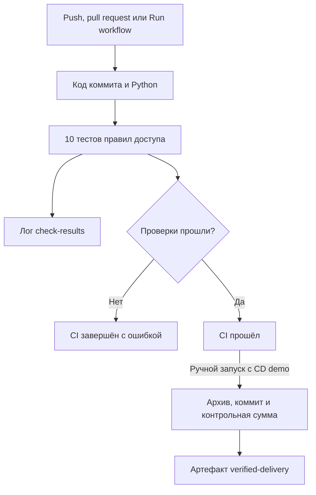

# AI Agent Security Lab

**10 рисков ИИ — простыми словами, схемами и кодом защиты.**

Автор: [Stefan / Keedz1Off](https://github.com/Keedz1Off) · AI Agent Security · инварианты и фаззинг

## Что открыть

| Ссылка | Что там |
| --- | --- |
| [Карточки рисков](docs/BASIC.md) | Короткие схемы и объяснения для начала. |
| [Код правил доступа](lab.py) · [Тесты](tests/test_lab.py) | Что проверяет локальный агент и где заданы ожидаемые результаты. |
| [Как работает пример](#как-работает-пример) · [Тестовый пайплайн](#тестовый-пайплайн) | Как предложение действия проходит проверки и как тесты читают результат. |
| [GitHub Actions](#github-actions) | Как открыть запуск, лог и архив CD demo. |

## Начни с простой базы

[Открыть: 10 рисков — уязвимый код и защита через `if/else`](docs/BASIC.md)

Там каждый риск показан по одной схеме: сначала плохой код, затем короткая проверка, которая останавливает опасное действие.

## 10 простых карточек

В каждой: **пример → схема проблемы → схема защиты → короткий код**.

| № | Что может пойти не так |
| --- | --- |
| 01 | [Подмена документа / инструкции](docs/BASIC.md#llm01) |
| 02 | [Чужой документ в ответе](docs/BASIC.md#llm02) |
| 03 | [Подмена библиотеки или модели](docs/BASIC.md#llm03) |
| 04 | [Подмена данных для обучения](docs/BASIC.md#llm04) |
| 05 | [Ответ ИИ вставляется на страницу](docs/BASIC.md#llm05) |
| 06 | [У агента слишком много прав](docs/BASIC.md#llm06) |
| 07 | [Секрет спрятан в системном промпте](docs/BASIC.md#llm07) |
| 08 | [Поиск нашёл документ другой команды](docs/BASIC.md#llm08) |
| 09 | [ИИ уверенно выдумал факт](docs/BASIC.md#llm09) |
| 10 | [Агент работает бесконечно](docs/BASIC.md#llm10) |

Начни с **01 → 06 → 02**: чужие инструкции, лишние права, утечка данных. Затем читай остальные в любом порядке. Старые подробные заметки лежат в папке [docs](docs).

## Как работает пример



Правила находятся в [lab.py](lab.py). Предложения действий создают примеры и тесты. Для текста, который попадёт в HTML, отдельно вызывается `render_text`.

## Тестовый пайплайн



В [tests/test_lab.py](tests/test_lab.py) находятся все 10 тестов. Они проверяют разрешённый документ, отклонённые действия, счётчик выполнений, лимит попыток и обработку HTML-текста. Генератор случайных входов использует фиксированный seed.

## Запусти пример

Python 3.11+, без установки библиотек и API-ключа. Из папки репозитория:

```bash
python examples/llm01.py
python examples/llm02.py
python -m unittest discover -s tests -v
```

Остальные примеры: `llm03.py` … `llm10.py` в папке [examples](examples).

## GitHub Actions

[Открой Policy tests](https://github.com/Keedz1Off/ai-agent-security-lab/actions/workflows/checks.yml) и нажми **Run workflow**. CI запускает 10 тестов локальных правил и сохраняет лог `check-results`. Галочка **CD demo** добавляет архив `verified-delivery` с логом, SHA коммита и контрольной суммой.

### Схема CI



### Что делает workflow

| Шаг | Что происходит |
| --- | --- |
| Подготовка | GitHub берёт код выбранного коммита и открывает Python 3.12 на Ubuntu. |
| Тесты | `unittest` запускает 10 проверок прав доступа, обработки HTML и лимита попыток. |
| Лог | Результат сохраняется в `check-results`. |
| CD demo | После успешного ручного прогона GitHub собирает лог, SHA коммита и контрольную сумму в `verified-delivery`. |

[Файл workflow](.github/workflows/checks.yml).

## Что здесь проверяется

**Рабочий lab:** права инструментов, доступ к выбранному документу, безопасный HTML-текст и лимит попыток. 10 тестов, включая 2 000 случайных предложений действий с фиксированным seed.

**Остальные карточки:** маленькие иллюстрации отдельных защит. Это не полноценные реализации каждой категории. Данные вымышлены; настоящая модель и внешние сервисы не запускаются.

Фаззинг — основное направление дальнейшей работы. Сейчас используется простой воспроизводимый генератор случайных входов.

<details>
<summary>Версия OWASP и технические подробности</summary>

Классификация закреплена на [OWASP LLM Top 10 — 2025](https://genai.owasp.org/llm-top-10/). Это независимый учебный проект, а не официальная разработка OWASP. Карточки объясняют категории рисков, а не десять обнаруженных уязвимостей.

[Подробности реализованных контролей](docs/CONTROLS.md) · [Методика тестов](docs/TESTING.md)

</details>
